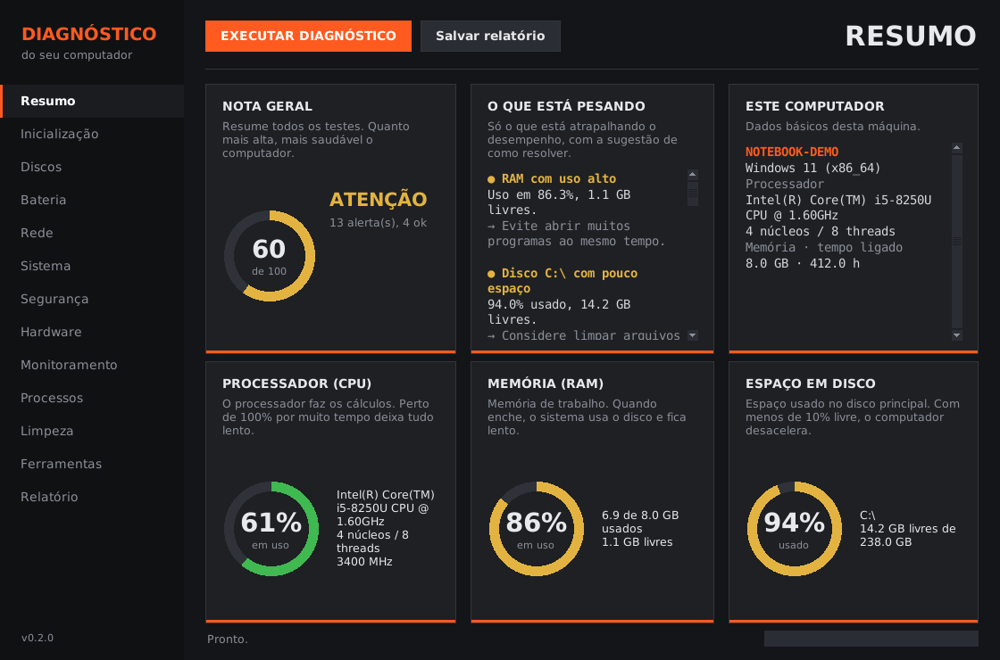
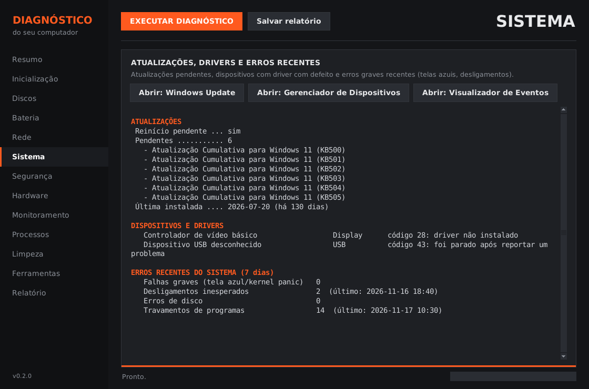
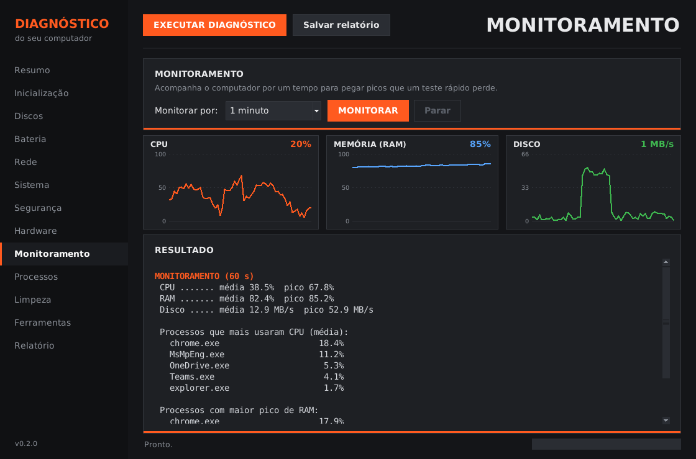
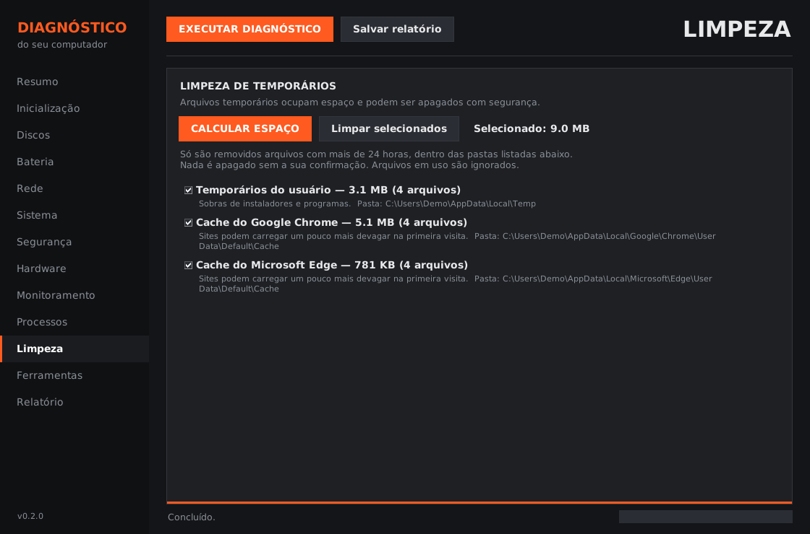

# 🖥️ Diagnóstico

> **Descubra por que o seu computador está lento, em linguagem simples.**
> Aplicativo gratuito para **Windows e macOS** que examina o computador, aponta as causas prováveis de lentidão e sugere o que fazer. Funciona 100% no seu computador, sem enviar dados para a internet e sem depender de inteligência artificial.

Projeto desenvolvido para a disciplina **Projetos – Desenvolvimento de Software para a Sociedade** (modalidade: *projeto novo*).



---

## 📑 Sumário

1. [Sobre o projeto](#1--sobre-o-projeto)
2. [Funcionalidades](#2--funcionalidades)
3. [Capturas de tela](#3--capturas-de-tela)
4. [Instalação e uso](#4--instalação-e-uso)
5. [Como funciona (arquitetura)](#5--como-funciona-arquitetura)
6. [Tecnologias e justificativas](#6--tecnologias-e-justificativas)
7. [Privacidade e segurança](#7--privacidade-e-segurança)
8. [Limitações conhecidas](#8--limitações-conhecidas)
9. [Gestão do projeto no GitHub](#9--gestão-do-projeto-no-github)
10. [Roadmap](#10--roadmap)
11. [Equipe e contexto acadêmico](#11--equipe-e-contexto-acadêmico)
12. [Referências](#12--referências)

---

## 1. 📋 Sobre o projeto

### Problema identificado

Quando o computador fica lento, muita gente conclui que ele está "velho" e que precisa ser trocado. Na prática, a causa costuma ser simples e corrigível: programas demais abrindo junto com o sistema, disco quase cheio, HD mecânico em vez de SSD, atualização pendente, driver com defeito, bateria desgastada ou rede instável.

O difícil é **descobrir** qual é a causa. Isso exige conhecimento técnico, vários programas diferentes e comandos que mudam entre Windows e Mac. Quem não tem esse conhecimento acaba gastando dinheiro com equipamento novo sem necessidade, ou convivendo com a lentidão.

### Solução proposta

Um aplicativo que faz **uma verificação completa, peça por peça**, e entrega:

- uma **nota geral** (Saudável, Atenção ou Crítico) para entender o estado do computador em poucos segundos;
- a lista do **que está pesando**, cada item com uma **sugestão de como resolver**;
- **explicações curtas** em cada bloco da tela, para o usuário entender o que está vendo, sem esconder os **dados técnicos** para quem quer o detalhe;
- um **relatório** que pode ser salvo e anexado a um chamado de suporte.

### Público-alvo

- Pessoas comuns, sem conhecimento técnico, com computador lento;
- Quem presta suporte informal (família, vizinhos, colegas);
- Escolas, associações, ONGs e microempresas sem equipe de TI;
- Profissionais de suporte, que ganham um relatório pronto para o chamado.

### Impacto social

| Dimensão | Como o projeto contribui |
|----------|--------------------------|
| **Economia** | Ajuda a corrigir o problema antes de gastar com equipamento novo, o que importa principalmente para quem tem pouco orçamento. |
| **Meio ambiente** | Prolongar a vida útil de computadores que ainda funcionam reduz a geração de lixo eletrônico. |
| **Inclusão digital** | Traduz termos técnicos para linguagem simples, tornando o diagnóstico acessível a quem não é da área. |
| **Instituições com poucos recursos** | Gratuito e local: escolas e ONGs podem manter seus equipamentos sem depender de serviços pagos. |
| **Privacidade** | Nada é enviado para servidores: o diagnóstico acontece no próprio computador. |

> O impacto descrito acima é o **potencial** da solução. A validação com usuários reais está no [roadmap](#10--roadmap).

### Definição do MVP

As três funcionalidades essenciais, que já estão entregues:

1. **Diagnóstico com nota geral** e causas prováveis de lentidão, com sugestões;
2. **Monitoramento com duração à escolha**, com gráficos ao vivo, para pegar picos que um teste rápido perde;
3. **Relatório** salvo em arquivo de texto.

O restante (limpeza, bateria, rede, segurança, hardware etc.) são evoluções sobre esse núcleo.

---

## 2. ✨ Funcionalidades

| Área | O que faz | Windows | Mac |
|------|-----------|:-------:|:---:|
| **Nota geral** | Pontuação de 0 a 100: Saudável (100), Atenção (60–89), Crítico (até 59) | ✅ | ✅ |
| **Resumo** | CPU, memória e disco em medidores, mais o que está pesando e as sugestões | ✅ | ✅ |
| **Inicialização** | Programas que abrem com o sistema e alerta quando há muitos | ✅ | ✅ |
| **Tempo de boot** | Quanto o sistema levou para iniciar e o que mais atrasou | ✅ | — |
| **Discos** | Tipo (SSD ou HD), saúde e partições | ✅ | ✅ |
| **Bateria** | Desgaste, ciclos de carga e carga atual | ✅ | ✅ |
| **Rede** | Latência, perda de conexão e tempo de DNS | ✅ | ✅ |
| **Sistema** | Atualizações pendentes, reinício pendente, dispositivos com driver com erro e erros recentes | ✅ | ✅ (parcial) |
| **Segurança** | Antivírus e firewall (Windows); FileVault, firewall, SIP e Gatekeeper (Mac) | ✅ | ✅ |
| **Hardware** | Modelo, número de série, placa-mãe, BIOS, memória e placa de vídeo | ✅ | ✅ |
| **Monitoramento** | Acompanha por um tempo escolhido (de 5 s a 1 h) com gráficos ao vivo | ✅ | ✅ |
| **Processos** | Programas que mais consomem CPU e memória | ✅ | ✅ |
| **Limpeza** | Estimativa e remoção de arquivos temporários, só com confirmação | ✅ | ✅ |
| **Ferramentas** | Atalhos para as ferramentas do sistema e reabrir como administrador | ✅ | ✅ (atalhos) |
| **Relatório** | Salva o diagnóstico completo em `.txt` | ✅ | ✅ |

### Principais regras do diagnóstico

O diagnóstico usa **regras simples e transparentes** (sem IA), que qualquer pessoa pode ler em [`diagnostico/analise.py`](diagnostico/analise.py):

| Item | Atenção | Crítico |
|------|---------|---------|
| CPU em uso | 70% ou mais | 90% ou mais |
| Memória RAM em uso | 80% ou mais | 90% ou mais, ou menos de 1 GB livre |
| Espaço no disco | 85% ou mais | 95% ou mais, ou menos de 5 GB livres |
| Programas na inicialização | 10 ou mais | 20 ou mais |
| Tempo de boot | 90 s ou mais | 180 s ou mais |
| Bateria (capacidade restante) | menos de 80% | menos de 60% |
| Rede | latência de 120 ms ou mais, perda de 20% ou mais | latência de 300 ms ou mais, perda de 40% ou mais |
| Atualizações | 5 ou mais pendentes, reinício pendente ou última há mais de 90 dias | — |
| Erros recentes (7 dias) | desligamento inesperado, travamentos frequentes | tela azul / *kernel panic*, erros de disco repetidos |

---

## 3. 🖼️ Capturas de tela

> As imagens abaixo usam **dados de demonstração** de um notebook fictício com problemas, para mostrar como o aplicativo apresenta os alertas.

| Resumo | Sistema |
|:------:|:-------:|
|  |  |

| Monitoramento ao vivo | Limpeza de temporários |
|:---------------------:|:----------------------:|
|  |  |

---

## 4. 🚀 Instalação e uso

### Opção A: executável pronto (não precisa instalar Python)

O executável é gerado automaticamente pelo **GitHub Actions** a cada atualização do código.

1. No repositório, abra a aba **Actions** e entre na execução mais recente **Gerar executáveis** (com ✅).
2. Na seção **Artifacts**, baixe **Diagnostico-Windows** (ou **Diagnostico-Mac**).
3. Extraia o `.zip` e abra o programa:
   - **Windows:** `Diagnostico.exe`. Se aparecer o aviso azul do SmartScreen, clique em **Mais informações → Executar assim mesmo** (o programa não é assinado digitalmente).
   - **Mac:** o `.zip` baixado contém outro `Diagnostico-Mac.zip`; extraia-o e abra o app com **clique direito → Abrir** na primeira vez.

> O repositório é privado: é preciso estar logado no GitHub com acesso a ele para ver a aba Actions.

### Opção B: rodar a partir do código-fonte

**Requisitos:** Python 3.10 ou superior (testado com 3.12) com `tkinter` (já vem no instalador oficial do Python para Windows e macOS; no Linux: `sudo apt install python3-tk`).

```bash
git clone https://github.com/leonardoclira12/Diagn-stico.git
cd Diagn-stico
pip install -r requirements.txt

python run_gui.py          # abre a janela
python -m diagnostico      # versão de terminal (menu)
```

### Opção C: gerar o seu próprio executável

- **Windows:** dê dois cliques em `build_windows.bat`. O resultado fica em `dist\Diagnostico.exe`.
- **Mac:** execute `./build_mac.sh`. O resultado fica em `dist/Diagnostico.app`.

### Guia rápido de uso

1. Clique em **EXECUTAR DIAGNÓSTICO** e aguarde alguns segundos.
2. Veja a **nota geral** e o cartão **O que está pesando**, com a sugestão de cada item.
3. Explore as páginas do menu lateral para ver os detalhes técnicos. Cada bloco tem uma explicação curta do que significa.
4. Em **Monitoramento**, escolha o tempo (ex.: `30 segundos`, `5 minutos`, `1h`) e clique em **MONITORAR** para acompanhar os gráficos ao vivo. O botão **Parar** encerra antes e analisa o que foi coletado.
5. Em **Limpeza**, clique em **CALCULAR ESPAÇO**, marque o que deseja e confirme. Nada é apagado sem a sua confirmação.
6. Use **Salvar relatório** para guardar o resultado em um arquivo `.txt`.

💡 **Dica (Windows):** em **Ferramentas → Reabrir como administrador** o aplicativo libera dados que exigem permissão elevada, como o registro de eventos e o tempo de boot.

---

## 5. 🏗️ Como funciona (arquitetura)

```
┌──────────────────────────────────────────────┐
│  INTERFACES                                  │
│  Janela (tkinter, tema escuro) · Terminal    │
└─────────────────────┬────────────────────────┘
                      │
                      ↓
┌──────────────────────────────────────────────┐
│  APRESENTAÇÃO + ANÁLISE                      │
│  Regras simples → nota geral, alertas e      │
│  sugestões; mesmo texto na tela e no relatório│
└─────────────────────┬────────────────────────┘
                      │
                      ↓
┌──────────────────────────────────────────────┐
│  COLETORES (um por componente)               │
│  psutil · PowerShell/CIM (Windows) ·         │
│  system_profiler (Mac) · testes TCP/DNS      │
└──────────────────────────────────────────────┘
```

### Estrutura de pastas

```
.
├── run_gui.py                 # ponto de entrada da janela (usado no .exe)
├── requirements.txt           # dependências (psutil)
├── build_windows.bat          # gera o .exe
├── build_mac.sh               # gera o .app
├── .github/workflows/         # GitHub Actions: build automático dos executáveis
└── diagnostico/
    ├── __main__.py            # versão de terminal
    ├── interface.py           # menu de terminal
    ├── gui.py                 # janela principal (menu lateral e páginas)
    ├── tema.py                # tema escuro e componentes visuais
    ├── coleta.py              # reúne os coletores (leituras lentas em paralelo)
    ├── analise.py             # regras de diagnóstico e nota geral
    ├── apresentacao.py        # monta o texto de cada seção
    ├── monitor.py             # monitoramento com duração escolhida
    ├── relatorio.py           # exporta o relatório .txt
    ├── atalhos.py             # atalhos do sistema e reabrir como administrador
    └── coletores/             # um módulo por componente
        ├── _exec.py           # execução segura de comandos e PowerShell
        ├── cpu.py · memoria.py · disco.py · processos.py · sistema.py
        ├── discos_fisicos.py · bateria.py · rede.py · hardware.py
        ├── inicializacao.py · boot.py · atualizacoes.py · dispositivos.py
        └── eventos.py · seguranca.py · limpeza.py
```

### Decisões de projeto

- **Regras em vez de IA:** cada alerta tem um motivo explicável e um limite visível no código. Isso dá previsibilidade, funciona offline e não depende de serviços externos.
- **Leitura e interpretação separadas:** cada coletor tem uma função que apenas *interpreta* a saída do sistema, o que permite testar as regras com dados simulados.
- **Coleta em paralelo:** medições de CPU e memória são feitas primeiro, sem concorrência, para não serem distorcidas; as leituras lentas (PowerShell, rede) rodam depois, em paralelo.
- **Só leitura por padrão:** o aplicativo não altera o sistema. A única ação que apaga algo é a limpeza, com salvaguardas (veja [Privacidade e segurança](#7--privacidade-e-segurança)).

---

## 6. 🧰 Tecnologias e justificativas

| Tecnologia | Uso | Por quê |
|------------|-----|---------|
| **Python 3** | Linguagem principal | Multiplataforma, ótima para leitura de sistema e rápida de evoluir em 3 meses |
| **psutil** | CPU, memória, disco, processos, bateria, rede | Biblioteca madura que funciona igual em Windows e Mac |
| **tkinter** | Interface gráfica | Já vem com o Python, sem dependência extra; componentes próprios para o tema escuro |
| **PowerShell / CIM** | Leituras específicas do Windows | Acesso oficial a drivers, atualizações, eventos, segurança e hardware, com saída em JSON (independe do idioma do Windows) |
| **system_profiler, softwareupdate** | Leituras específicas do Mac | Ferramentas nativas do macOS |
| **PyInstaller** | Gera o `.exe` e o `.app` | Entrega um executável que não exige Python instalado |
| **GitHub Actions** | Build automático | Gera os executáveis de Windows e Mac sem precisar das duas máquinas |

---

## 7. 🔒 Privacidade e segurança

- **Tudo roda localmente.** O aplicativo não envia dados para nenhum servidor.
- **Conexões de rede feitas pelo app:** o teste de rede conecta aos servidores públicos `1.1.1.1` e `8.8.8.8` apenas para medir latência e resolve alguns nomes públicos para medir o DNS. No Windows, a busca de atualizações consulta o serviço do Windows Update, como o próprio sistema faz.
- **Só leitura:** nenhum programa é desativado, encerrado ou removido pelo aplicativo.
- **Limpeza com salvaguardas:**
  - pede **confirmação** antes de apagar;
  - remove apenas arquivos com **mais de 24 horas**;
  - atua **somente em pastas conhecidas** (temporários e caches); recusa a raiz do disco e a pasta pessoal;
  - **nunca segue atalhos** (links simbólicos) para fora dessas pastas;
  - ignora arquivos em uso.
- **Atenção ao compartilhar o relatório:** ele contém o **nome do computador** e o **número de série**. Revise antes de enviar a terceiros.

---

## 8. ⚠️ Limitações conhecidas

- O desenvolvimento e os testes foram feitos em **Linux**. As leituras específicas do Windows e do Mac foram construídas a partir da documentação oficial e testadas com **saídas simuladas**; a validação em mais equipamentos reais ainda é necessária.
- **Temperaturas e *thermal throttling* não estão incluídos:** no Windows dependem de drivers de terceiros e no Mac com Apple Silicon quase não há sensores expostos.
- Alguns dados (registro de eventos, tempo de boot) podem exigir **executar como administrador**.
- No Mac, a leitura dos Itens de Login pode pedir permissão de Automação na primeira vez.
- Os executáveis **não são assinados digitalmente**, então o Windows e o macOS mostram avisos na primeira execução.
- A busca de atualizações pendentes pode levar alguns segundos a mais.
- O diagnóstico indica **causas prováveis**, não certezas: lentidão intermitente pede um monitoramento mais longo.

---

## 9. 💻 Gestão do projeto no GitHub

### Como o desenvolvimento foi conduzido

O projeto evoluiu de forma incremental, **um commit por etapa**, com mensagens descritivas em português. Os principais marcos:

| Marco | O que foi entregue |
|-------|--------------------|
| 1. Ideia e MVP | Coletores básicos, análise por regras, menu de terminal e relatório `.txt` |
| 2. Interface e entrega | Janela gráfica, scripts de build e GitHub Actions para gerar `.exe` e `.app` |
| 3. Novos diagnósticos | Programas de inicialização, discos (SSD/HD e saúde), monitoramento com tempo escolhido |
| 4. Visão completa | Nota geral, bateria, rede e limpeza de temporários |
| 5. Interface redesenhada | Tema escuro, menu lateral, gráficos ao vivo e explicações curtas |
| 6. Ferramentas de suporte | Atualizações, drivers, erros recentes, boot, segurança, hardware, atalhos e modo administrador |

### Convenção de commits

Mensagens curtas e descritivas, no padrão [Conventional Commits](https://www.conventionalcommits.org/pt-br/v1.0.0/):

```
feat: adiciona leitura do tempo de boot
fix: ignora o System Idle Process na lista de processos
docs: atualiza instruções de instalação
refactor: unifica o texto do diagnóstico em apresentacao.py
```

### Fluxo de trabalho recomendado

```
main              código estável, sempre com o aplicativo funcionando
feature/<nome>    nova funcionalidade
bugfix/<nome>     correção de erro
```

Mudanças significativas entram na `main` por **Pull Request** com revisão de outro membro, e as tarefas são acompanhadas em **Issues** (`feature`, `bug`, `docs`, `enhancement`) e em um quadro **GitHub Projects** (To Do → In Progress → Review → Done).

### Build automático

Cada atualização na `main` dispara o workflow [`build.yml`](.github/workflows/build.yml), que gera os executáveis de Windows e de Mac. Se um deles falhar (por exemplo, por falta de máquina Mac disponível no GitHub), o outro continua.

---

## 10. 🗺️ Roadmap

- [x] Diagnóstico por regras com nota geral
- [x] Interface gráfica em tema escuro e versão de terminal
- [x] Monitoramento com duração escolhida e gráficos ao vivo
- [x] Bateria, rede, limpeza de temporários, segurança e hardware
- [x] Atualizações, drivers com erro, erros recentes e tempo de boot
- [x] Atalhos do sistema e reabrir como administrador
- [x] Executáveis gerados automaticamente (Windows e Mac)
- [ ] Validar o aplicativo com usuários reais e registrar o feedback
- [ ] Testes automatizados das regras de diagnóstico
- [ ] Ações que mexem no sistema, sempre com confirmação (desativar programa de inicialização, encerrar processo, limpar cache de DNS)
- [ ] Relatório em HTML ou PDF e histórico de diagnósticos para comparar ao longo do tempo
- [ ] Temperaturas e *thermal throttling*
- [ ] Ícone próprio e assinatura digital dos executáveis

---

## 11. 👥 Equipe e contexto acadêmico

| Integrante | Responsabilidades |
|------------|-------------------|
| **Leonardo** `[acrescentar sobrenome e matrícula]` | Concepção, desenvolvimento e documentação |
| `[demais integrantes, se houver]` | |

- **Disciplina:** Projetos – Desenvolvimento de Software para a Sociedade
- **Modalidade:** projeto novo
- **Escopo:** MVP funcional realista para 3 meses, com foco em qualidade e não em quantidade de recursos

---

## 12. 📚 Referências

1. [psutil, documentação oficial](https://psutil.readthedocs.io/)
2. [tkinter, documentação do Python](https://docs.python.org/3/library/tkinter.html)
3. [PyInstaller, documentação oficial](https://pyinstaller.org/)
4. [GitHub Actions, documentação](https://docs.github.com/actions)
5. [Get-CimInstance, documentação da Microsoft](https://learn.microsoft.com/powershell/module/cimcmdlets/get-ciminstance)
6. [Conventional Commits](https://www.conventionalcommits.org/pt-br/v1.0.0/)
